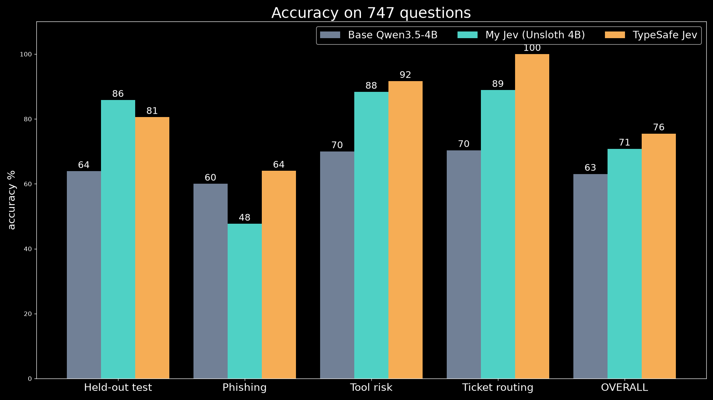

# Build Your Own Jev with Unsloth

Train a Jev-like **System One** classifier: it takes a `state`, a `question` and a list of
`options`, then returns **one letter** plus a probability for every option. The base model
is Qwen3.5-4B, fine-tuned with Unsloth on a RunPod GPU. Once trained, the model is published
to Hugging Face, served with vLLM and benchmarked against TypeSafe Jev on accuracy,
calibration, latency and cost.

```
state + question + options  ──►  my-jev-4b  ──►  "A"  +  {duplicate_charge: 0.998, ...}
```

**Use the trained model:** [Prompt48/my-jev-4b](https://huggingface.co/Prompt48/my-jev-4b)
(LoRA adapter: [Prompt48/my-jev-4b-lora](https://huggingface.co/Prompt48/my-jev-4b-lora))

## Results (747 questions, identical tasks for every model)

| | Base Qwen3.5-4B | **my-jev-4b** | TypeSafe Jev |
|---|---:|---:|---:|
| Held-out test (tev1 dev) | 63.9% | **85.8%** | 80.6% |
| Phishing (third-party) | 60.0% | 47.7% | **64.0%** |
| Tool risk (third-party) | 70.0% | 88.3% | **91.7%** |
| Ticket routing (third-party) | 70.4% | 88.9% | **100%** |
| **Overall** | 63.0% | 70.8% | **75.5%** |
| Calibration ECE (lower is better) | 0.144 | 0.212 | **0.111** |
| Median latency, benchmark run on the pod | 113 ms | **118 ms** | 269 ms |
| Median latency, from a laptop (both over the internet) | – | 461 ms | **357 ms** |

Training ran for 4 h 40 min on one A40 at $0.49/hr. The whole pod session cost about $3.
Phishing got *worse* after fine-tuning, because the training data contains no security or email tasks.
The full reports are in [`results/`](results/).



## What you need

- A RunPod pod with at least 24 GB VRAM: RTX 4090, L40S, A40 or A100. Use the **RunPod
  PyTorch** template, a 60 GB+ volume, and expose HTTP port **8000**.
- A Hugging Face **write** token.
- A TypeSafe API key, only needed for the Jev comparison.

## 1. Set up the pod

```bash
cd /workspace
git clone <this repo> my-jev && cd my-jev
cp .env.example .env && nano .env      # HF_TOKEN, HF_REPO, MY_JEV_API_KEY, TYPESAFE_API_KEY
bash setup_pod.sh                      # installs Unsloth + vLLM, builds the 37,840-example dataset
```

## 2. Train and publish

```bash
bash train.sh --max_train 200          # 2-minute smoke test first
bash train.sh                          # full run: 1 epoch, then pushes to Hugging Face
```

`train.sh` does the following:

1. Scores the **untrained** base model on a held-out dev set, which gives the "before" number.
2. Fine-tunes with LoRA. Loss is computed on the answer letter only.
3. Scores the model again for the "after" number, with accuracy, Brier and ECE.
4. Pushes `HF_REPO` (merged 16-bit weights for vLLM), `HF_REPO-lora` (the adapter) and a
   model card containing the results.

Add `--gguf` if you also want Ollama or llama.cpp builds. On GPUs under 24 GB, add
`--load_in_4bit`.

## 3. Serve

```bash
bash serve.sh                          # OpenAI-compatible API on :8000
```

The public URL is `https://<POD_ID>-8000.proxy.runpod.net/v1`.

Ask it one question, and optionally ask Jev the same question for comparison:

```bash
.venv-serve/bin/python ask.py examples/charge-dispute.json --jev
```

## 4. Benchmark against Jev

```bash
.venv-serve/bin/python bench.py --gpu_hourly 0.69     # your pod's $/hr
```

Both models run on identical tasks:

| Suite | What it is |
|---|---|
| `tev1_dev` | Held-out dev set: NLI, BoolQ, Banking77, AG News, SST-5, policy, routing, research taxonomy |
| `phishing` | PhishNChips, a third-party benchmark the model was never trained on |
| `tool_risk` | Third-party agent tool-risk labels |
| `ticket_routing` | Third-party support ticket routing |

The output goes to `bench_results/report.md` and covers:

- accuracy per suite
- Brier score and ECE, which measure calibration
- latency at p50, p90 and p99 with one request at a time
- burst throughput
- cost per 1,000 decisions

Run the benchmark **from the pod** so your model is measured on localhost. Jev is always
measured over the internet. To compare network conditions like-for-like, run it a second
time from your laptop against the RunPod proxy URL.

## Recipe

This mirrors Together's tev1 so the comparison is fair:

| Setting | Value |
|---|---|
| Base | Qwen3.5-4B, thinking off |
| LoRA | r 8, alpha 16, all linear layers, dropout 0 |
| Optimizer | AdamW 8-bit, lr 5e-5, cosine, warmup 3% |
| Epochs / batch | 1 / 8 |
| Max length | 2,048 tokens |
| Loss | Completion only (the answer letter + `<|im_end|>`) |

`recording/` has the scripts used to record the terminal demos for the video (asciinema + agg).

Credits: the dataset pipeline comes from [togethercomputer/tev1](https://github.com/togethercomputer/tev1)
(MIT). The training uses [Unsloth](https://github.com/unslothai/unsloth).
